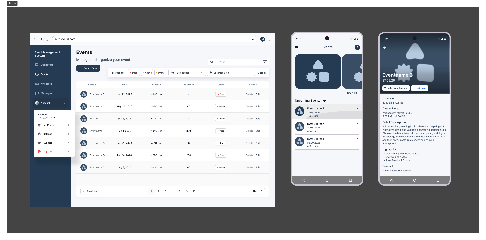
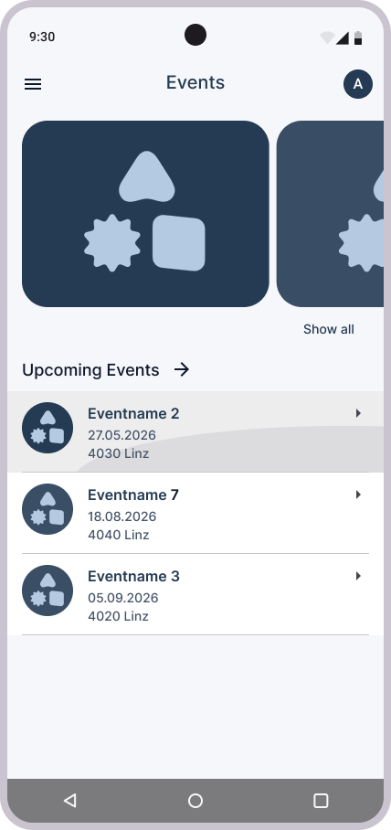

# CMS Dashboard UI
Event-Management System mit CMS- und App-Interface für konsistente Nutzererlebnisse

## Überblick 
Dieses Projekt untersucht das Design und die konzeptionelle Frontend-Umsetzung eines verbundenen CMS- und App-Systems zur Verwaltung und Darstellung von Events.

## Problem
Event-Organisatoren benötigen eine effiziente Möglichkeit zur Erstellung und Verwaltung von Events, während Nutzer in der App eine klare und konsistente Darstellung erwarten.

## Ziel 
Entwicklung eines konsistenten CMS- und App-Systems mit klarer Struktur, intuitiver Navigation und einheitlichem Nutzererlebnis.

## Technologien / Tools 
Figma · UI/UX Design · Prototyping · User Flows

## Rolle
UI/UX Design · Prototyping · Informationsarchitektur

## Prozess
* Analyse der Informationsstruktur
* Erstellung von User Flows für CMS und App
* Entwicklung mehrerer Wireframe-Ansätze
* Ausarbeitung eines konsistenten UI-Konzepts in Figma

## Lösung
* CMS zur strukturierten Eventverwaltung
* App-Interface zur Darstellung und Entdeckung von Events
* Einheitliche visuelle und interaktive Sprache zwischen beiden Systemen

# Design Screens 

## Übersicht (CMS + App)
  - Verbundene Interfaces für Eventverwaltung und Eventdarstellung

## CMS UI
  - Das CMS wird von Veranstaltern genutzt, um Veranstaltungen zu erstellen, zu verwalten und zu aktualisieren.
  - Übersicht aller Events mit Fokus auf schnelle Bearbeitung und klare Struktur.

## CMS UI 
- Filteroptionen

## CMS UI 
- Account Popup Sidebar

## Mobile App UI
  - Die App wird von Kunden genutzt, um bevorstehende Veranstaltungen zu entdecken und Veranstaltungsdetails einzusehen.
  - links: Nutzer können kommende Events schnell durchsuchen und visuell erfassen.
  - rechts: Detaillierte Eventansicht mit Fokus auf klare Informationshierarchie.

## Wichtige Erkenntnisse
Das Design zweier miteinander verbundener Systeme (Admin + Nutzer) verbessert die Verständlichkeit und Konsistenz des gesamten Nutzererlebnisses deutlich.

## Hinweis
Die deutsche Aufgabenstellung befindet sich in der Datei "task-challenge-de.txt", die englische Version in der Datei "task-challenge-en.txt".

