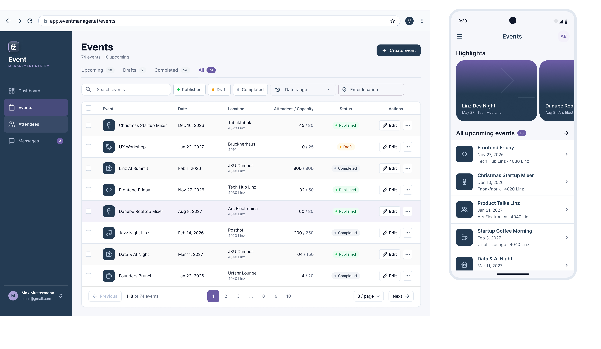
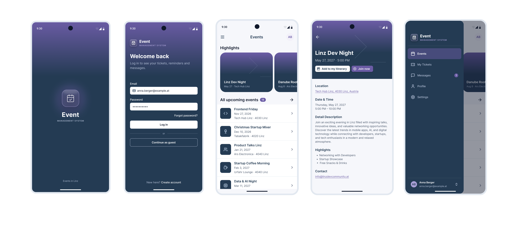

# CMS Dashboard UI
Event-Management System mit CMS- und App-Interface für konsistente Nutzererlebnisse

## Überblick 
Dieses Projekt untersucht das Design und die konzeptionelle Frontend-Umsetzung eines verbundenen CMS- und App-Systems zur Verwaltung und Darstellung von Events.

## Problem
Event-Organisatoren benötigen eine effiziente Möglichkeit zur Erstellung und Verwaltung von Events, während Nutzer in der App eine klare und konsistente Darstellung erwarten.

## Ziel 
Entwicklung eines konsistenten CMS- und App-Systems mit klarer Struktur, intuitiver Navigation und einheitlichem Nutzererlebnis.

## Technologien / Tools 
Figma · UI/UX Design · Prototyping · User Flows

## Rolle
UI/UX Design · Prototyping · Informationsarchitektur

## Prozess
* Analyse der Informationsstruktur
* Erstellung von User Flows für CMS und App
* Entwicklung mehrerer Wireframe-Ansätze
* Ausarbeitung eines konsistenten UI-Konzepts in Figma

## Lösung
* CMS zur strukturierten Eventverwaltung
* App-Interface zur Darstellung und Entdeckung von Events
* Einheitliche visuelle und interaktive Sprache zwischen beiden Systemen

# Design Screens 

## Übersicht (CMS + App)
  - Das System besteht aus einem verbundenen CMS und einer mobilen Anwendung, die gemeinsam eine durchgängige Lösung für die Eventverwaltung und Eventdarstellung bieten.

- In der App werden ausschließlich jene Events angezeigt, die im CMS als aktiv markiert sind. Dadurch wird eine klare Trennung zwischen Entwurfs- bzw. inaktiven Inhalten und veröffentlichten Events gewährleistet.

Der Unterschied wird im folgenden Beispiel deutlich dargestellt: Nur aktiv geschaltete Events sind in der App sichtbar, während deaktivierte Events vollständig ausgeblendet bleiben.

## Mobile App UI
- Die Mobile App ist für Endnutzer konzipiert und dient als Plattform zur Entdeckung und Darstellung bevorstehender Veranstaltungen.
- Der Fokus liegt auf einer intuitiven, visuell orientierten User Experience mit klarer Informationsstruktur.

- Linke Ansicht:
  - Die Übersicht ermöglicht das schnelle Durchsuchen kommender Events.
  - Inhalte werden visuell priorisiert dargestellt, um eine effiziente Erfassung relevanter Veranstaltungen zu unterstützen.

- Rechte Ansicht:
  - Die Eventdetailansicht stellt umfassende Informationen zum ausgewählten Event bereit.
  - Die UI folgt einer klaren Informationshierarchie, wodurch Inhalte strukturiert, leicht verständlich und schnell erfassbar präsentiert werden.

## Verwendete Color Styles für UI
- Die Benutzeroberflächen von CMS und Mobile App basieren auf einem konsistenten Color-System zur Unterstützung einer klaren visuellen Hierarchie und einer einheitlichen User Experience.

- Die definierten Color Styles werden systemweit für zentrale UI-Komponenten wie Navigation, Buttons, Statusanzeigen, Cards und interaktive Elemente verwendet. 
- Durch den konsistenten Einsatz von Primär-, Sekundär- und Statusfarben wird die Wiedererkennbarkeit der Anwendung erhöht sowie die Benutzerführung visuell unterstützt. 

------
## Wichtige Erkenntnisse
Das Design zweier miteinander verbundener Systeme (Admin + Nutzer) verbessert die Verständlichkeit und Konsistenz des gesamten Nutzererlebnisses deutlich.

## Hinweis
- Die deutsche Aufgabenstellung befindet sich in der Datei `task-challenge-de.txt`, die englische Version in der Datei `task-challenge-en.txt`.
- Weitere Screenshots zum Projekt befinden sich im Ordner `cms-desktop` und `cms-mobile`.

